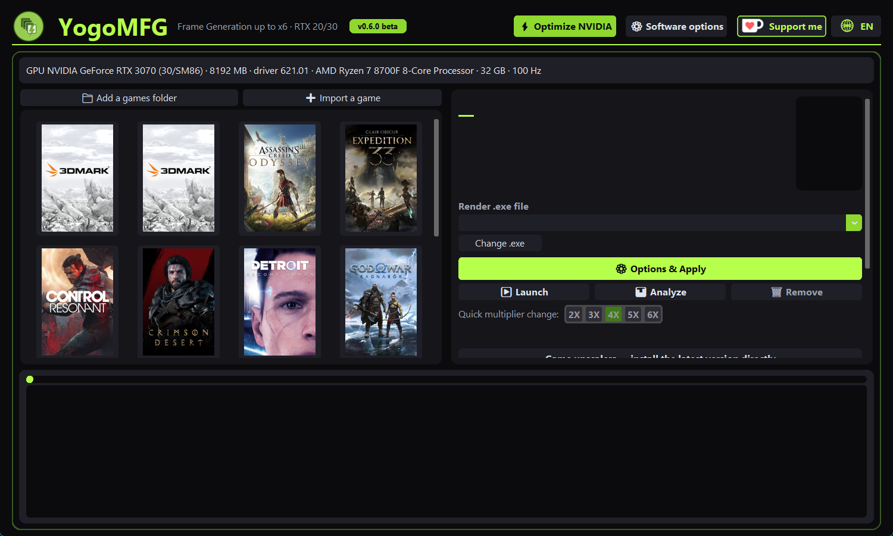
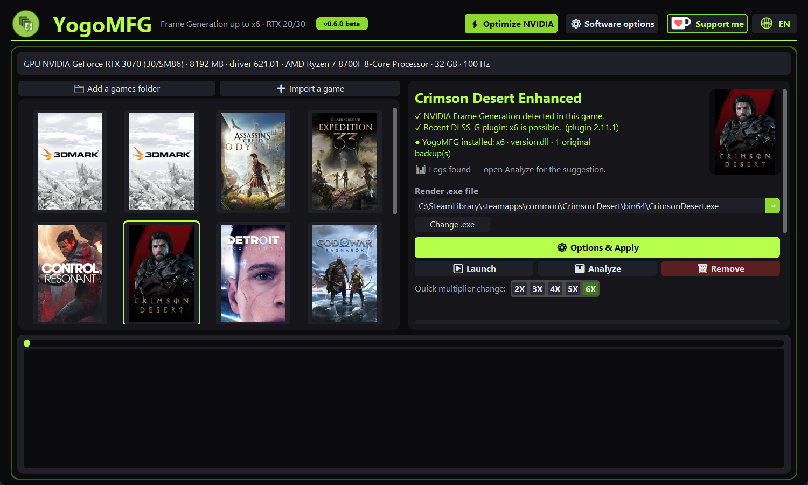
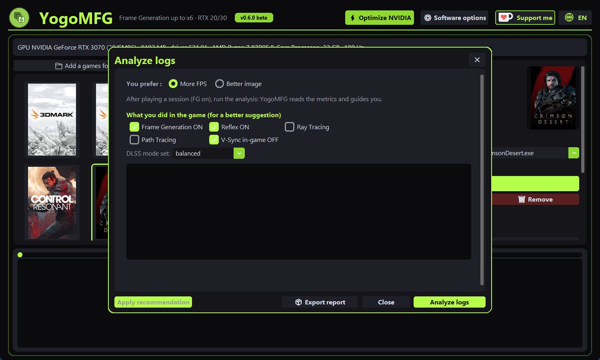
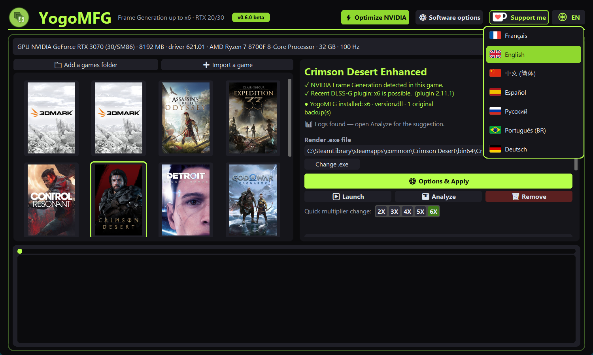

# YogoMFG

**DLSS Frame Generation sur les cartes NVIDIA RTX 20 et 30 — un clic pour l'activer, un clic pour tout retirer.**

🇬🇧 [Read in English](README.md)

YogoMFG installe le **mod Frame Generation SM86 / SM75** (binaires tiers, voir [Le mod et sa
sécurité](#le-mod-et-sa-sécurité)) dans tes jeux Steam et règle le profil NVIDIA du jeu. Tu cliques **Optimiser ce
jeu** : YogoMFG choisit tout pour une image propre, sans ghosting. Tu cliques **Retirer et restaurer** : les fichiers
d'origine du jeu reviennent, vérifiés octet par octet, sans passer par Steam. Il mesure ensuite ta session de jeu et
t'explique, en mots simples, ce qui limite tes FPS.

> Testé par l'auteur : RTX 3070 8 Go, Ryzen 7 8700F, écran 1440p 180 Hz G-Sync, **Crimson Desert** en x6 ≈ 160 FPS
> affichés, fluide en régime stable. Tes résultats dépendent de ton jeu, de ta carte et de tes réglages.

> ⛔ **Jeux solo / hors ligne uniquement.** N'utilise jamais YogoMFG sur un jeu en ligne ou avec anti-cheat :
> risque de bannissement définitif. Lis [ANTICHEAT.md](ANTICHEAT.md) (FR, EN, ES, DE, PT-BR, IT, 中文).

---

## Un projet gratuit, fait pour aider

YogoMFG est un projet **à but non lucratif et gratuit**. Il existe par entraide : améliorer le confort de jeu de chacun et
**prolonger la vie des anciennes cartes graphiques** au lieu de les jeter.

Un grand **merci** à toutes celles et ceux qui téléchargent, testent et partagent. C'est une bêta : vos retours la font progresser.

- Un bug ? Un jeu qui se comporte bizarrement ? Une question ? **Dites-le-nous : nous sommes là pour résoudre vos problèmes.**
- Le plus simple pour signaler : optimise le jeu, joue 3 à 5 minutes (la session est toujours mesurée), ferme le jeu, puis
  **Options logiciel → 📦 Exporter le rapport** et envoie-nous le `.zip` (réglages et logs, sans ton nom d'utilisateur Windows).
- Ouvre un ticket (issue) sur la page du projet, ou contacte directement l'auteur.

Si YogoMFG t'a aidé et que tu veux soutenir le travail : ☕ **[ko-fi.com/lahlouyoussef](https://ko-fi.com/lahlouyoussef)**
Le lien Ko-fi accepte **toutes sortes de soutiens** : un café, un **don** ponctuel, un abonnement mensuel, ou simplement un
message d'encouragement. Jamais obligatoire — l'outil reste gratuit.

---



*(Captures en anglais ; l'interface est disponible en français via le bouton globe.)*

## Ce qu'il fait

- **Une grille de jaquettes pour tous tes jeux** : bibliothèques Steam trouvées automatiquement, ajout d'un dossier ou d'un jeu isolé.
- **Te dit si un jeu supporte la Frame Generation.**
- **Optimiser ce jeu** — un bouton, rien à choisir. La cible est la fréquence de ton écran le plus rapide (3 FPS en
  dessous sur G-Sync / FreeSync, pour rester dans la plage variable) ; cette cible est aussi le cap FPS écrit dans le
  profil NVIDIA du jeu. Le multiplicateur reste toujours entre **x3 et x6** (le x2 est laissé à la Frame Generation
  FSR d'AMD). La première fois, il vise environ 55 images réelles par seconde : 144 Hz → x3, 180 Hz → x3,
  240 Hz → x4, 360 Hz → x6. Après quelques minutes de jeu, YogoMFG **se calibre** sur la
  session mesurée (voir plus bas). La fiche affiche le résultat en une ligne, par exemple
  *x3 · 59 images calculées → 177 affichées*.
- **Retirer et restaurer** — un bouton. Chaque fichier ajouté par YogoMFG est supprimé, chaque fichier du jeu qu'il a
  remplacé est remis et vérifié (SHA-256), et les réglages du profil NVIDIA du jeu sont annulés. Quand plus aucun
  autre jeu n'utilise YogoMFG, les valeurs globales NVIDIA d'origine sont remises aussi. Pas besoin de « vérifier
  les fichiers » dans Steam.
- **Ce qui est écrit dans le pilote NVIDIA** : dans le profil du jeu, le cap FPS, G-Sync / FreeSync (si l'écran le
  gère) et le nombre d'images générées. Dans le profil global, seulement le *plafond* de la Frame Generation (jusqu'à
  x6, pour que les jeux aient le droit de l'atteindre) et G-Sync / FreeSync en plein écran et en fenêtré ; jamais un
  multiplicateur imposé, qui s'appliquerait à tous les jeux. Les valeurs globales d'origine sont sauvegardées avant.
- **Un clic vaut accord** : pas d'écran de confirmation. Chaque écriture est relue et vérifiée, affichée dans la
  console, et annulée par *Retirer et restaurer*.
- **Gestion des upscalers** : détecte DLSS / FSR / XeSS dans le jeu et met la DLL à jour.
- **Mesure et analyse de session** : FPS réels, temps GPU, lien PCIe, limites de puissance et de chaleur → un verdict clair.
- **7 langues** avec drapeaux : English, Français, Español, Deutsch, Português, Русский, 中文 (bouton globe).

## Ce qu'il te faut

Windows 10/11 64 bits · carte NVIDIA **RTX 20 ou 30** · pilote NVIDIA **R580 ou plus récent** (le mod refuse de démarrer
avec un pilote plus ancien) · droits administrateur · un jeu Steam qui a déjà la DLSS Frame Generation (Streamline
`sl.dlss_g`).

Inutile sur RTX 40/50 : elles ont la Frame Generation en natif.

## Installation et utilisation

1. Lance `YogoMFG-Setup-<version>.exe` (ou le `YogoMFG.exe` portable) et accepte l'avertissement anti-cheat.
2. Clique la **jaquette** de ton jeu. YogoMFG dit si le jeu supporte la Frame Generation.
3. Clique **Optimiser ce jeu**. Rien à confirmer : le clic vaut accord.
4. Lance le jeu avec le bouton **Launch** de YogoMFG et active la Frame Generation dans les options graphiques du jeu.
5. Pour tout annuler : **Retirer et restaurer**.

Tes réglages sont dans `%LOCALAPPDATA%\YogoMFG`.

### Pas à pas

1. **Choisis ton jeu** : clique sa jaquette. La fiche à droite dit si le jeu supporte la Frame Generation et si YogoMFG est déjà installé.
   
2. **Optimiser ce jeu** : avant d'écrire quoi que ce soit, YogoMFG déplace chaque fichier du jeu qu'il remplacerait dans
   `YogoMFG_backup\` à côté du `.exe` du jeu, avec un `manifest.json` qui liste chaque fichier, son SHA-256 et s'il a été
   remplacé ou ajouté. Il pose ensuite le mod avec des réglages fixes et sûrs (image identique au runtime officiel
   NVIDIA, aucun raccourci avec perte) et écrit le cap FPS, G-Sync / FreeSync et le multiplicateur dans le profil NVIDIA
   du jeu. La ligne sous les boutons dit ce que tu obtiens, par exemple *x3 · 59 images calculées → 177 affichées*.
3. **Joue** 3 à 5 minutes : au clic suivant sur **Optimiser** (ou au prochain démarrage), YogoMFG analyse la session tout seul et recalibre. *Options logiciel → Exporter le rapport* crée le `.zip` à nous envoyer en cas de souci.
   
4. **Calibrage automatique** : chaque session est mesurée (images réelles par seconde, charge du GPU ; menus, pauses et
   cinématiques sont écartés car la Frame Generation s'y arrête). Après 3 à 5 minutes de jeu, le clic suivant sur
   *Optimiser ce jeu*, ou le prochain démarrage de YogoMFG, recalcule le multiplicateur et réécrit les réglages du mod et
   le profil du jeu s'il a changé. Il te le dit en une ligne, par exemple *Calibré : x3, 59 images réelles → 177
   affichées*. La règle, en mots simples :
   - YogoMFG prend le nombre d'images réelles que ta carte tient sans faiblir (le bas de la session, pas la moyenne) et
     choisit le **plus petit** multiplicateur qui atteint quand même la cible. Moins d'images inventées entre deux images
     réelles, c'est une image plus propre.
   - Si les images réelles restent collées sur une ligne plate alors que la carte n'est pas à fond, c'est que le jeu
     (ou toi) les a plafonnées. YogoMFG respecte ce plafond : cible divisée par le plafond, arrondie (un plafond à 60
     sur un écran 180 Hz donne x3, 45 donne x4, 30 donne x6), et jamais plus d'images que l'écran ne peut en afficher
     (sinon saccades ou déchirures).
   - Le multiplicateur reste entre x3 et le maximum que le jeu a prouvé savoir donner (x6 au plus ; Resident Evil
     Requiem s'arrête à x4). Si même ce maximum ne suffit pas, YogoMFG le prend et l'écran G-Sync / FreeSync absorbe
     l'écart.
   - Si le jeu tombait sous 45 images réelles par seconde, le réglage est quand même appliqué mais YogoMFG prévient :
     *image moins nette : baisser un réglage graphique dans le jeu (DLSS Équilibré, ombres)*. Sur les cartes d'entrée
     de gamme (RTX 2050, RTX 2060), ou quand la base mesurée reste sous 45, 30 images réelles sont acceptées sans
     avertissement.
5. **Retirer et restaurer** : supprime ce que YogoMFG a ajouté, remet chaque fichier remplacé, vérifie son SHA-256, puis
   supprime le dossier de sauvegarde, et annule les changements du profil NVIDIA du jeu. Si une vérification échoue, la
   sauvegarde est gardée et YogoMFG dit quel fichier. Les installations faites par YogoMFG 0.6.x (fichiers `.yogobak`)
   sont restaurées aussi.
6. **Langue** : bouton globe en haut à droite.
   

## Quel multiplicateur mon jeu aura-t-il vraiment ?

Le plafond dépend du jeu, pas de ta carte. Mesuré par nous, sur de vrais logs de session (RTX 3070) :

| Jeu | Plugin dans le dossier du jeu | Résultat |
|---|---|---|
| Crimson Desert | 2.11.1 | **x6** |
| CONTROL Resonant | 2.12.128 | **x6** |
| God of War Ragnarök | 2.4.15 (le jeu appelle la Frame Generation directement) | **x6** — le menu du jeu ne propose que x2 ; l'override du profil NVIDIA force plus |
| Resident Evil Requiem | 2.8.0 | **x4 maximum** — le jeu ignore la demande x6 du pilote |

Les autres jeux ne sont pas encore testés. La version du plugin seule **ne dit pas** le plafond (voir God of War et Resident Evil).
YogoMFG ne devine donc pas : joue quelques minutes, et YogoMFG **mesure** ce que le jeu a vraiment donné. Si le jeu a
donné moins que demandé, ce plafond est retenu pour ce jeu et le prochain *Optimiser* reste en dessous.
Envoie-nous tes résultats (*Options logiciel → Exporter le rapport*) pour allonger cette liste.

## À savoir (bêta)

- **L'image propre d'abord** : le multiplicateur est le plus petit qui atteint la fréquence de ton écran. Un fort
  multiplicateur sur peu d'images réelles fait du ghosting ; YogoMFG l'évite exprès.
- Le multiplicateur est écrit dans le profil NVIDIA du jeu : **ne change pas** la Frame Generation dans le menu du jeu
  et n'utilise pas « Dynamique ». Active simplement la Frame Generation.
- Sur écran G-Sync / FreeSync, YogoMFG **ne force jamais le V-Sync**.
- Écran FreeSync : active une fois « G-SYNC Compatible » dans le Panneau de configuration NVIDIA → Affichage →
  Configurer G-SYNC. C'est un réglage de l'écran, pas d'un profil : YogoMFG ne peut ni le lire ni le changer.
- Avec plusieurs écrans, YogoMFG suppose que le jeu tourne sur le plus rapide.
- Un autre mod de Frame Generation dans le dossier du jeu (OptiScaler, dlssg-to-fsr3, DLSS Enabler…) bloque l'application :
  retire-le d'abord.
- Les forts multiplicateurs demandent de la mémoire vidéo : sur une carte 8 Go, baisse les textures si tu as des saccades.
- YogoMFG écrit dans le **profil pilote NVIDIA** du jeu. N'utilise pas « Delete » sur un profil de jeu dans NVIDIA
  Profile Inspector.

## Le mod et sa sécurité

Le mod Frame Generation **n'est pas open source** : ce sont des binaires tiers fermés (un proxy `version.dll` et le
dossier `dlssg_sm86\`) publiés sur GitHub par **sdli1995**. YogoMFG 0.7.0 embarque sa release **0.4.1**, publiée par
Coldwood1026. L'archive contient aussi les DLL DLSS de NVIDIA, non modifiées.

Contrôles faits avant de l'embarquer :

- le SHA-256 du zip téléchargé sur GitHub correspond à l'empreinte publiée avec la release ;
- analyse Microsoft Defender : rien de détecté ;
- les DLL NVIDIA portent une signature NVIDIA valide ; les DLL du mod sont auto-signées (« DLSSG Throwaway Test »), ce
  qui prouve qu'elles n'ont pas été modifiées après signature, mais pas qui les a faites.

La limite : un code fermé ne peut pas être audité entièrement. Ces contrôles montrent que les fichiers sont bien ceux
publiés et qu'ils ne sont pas des malwares connus ; ils ne peuvent pas prouver ce que fait le code. Utilise-le
seulement sur des jeux solo, et pense à *Retirer et restaurer* si quelque chose te semble anormal.

## Feuille de route — prochaine fonctionnalité

**Frame Generation pour les jeux qui ne la supportent pas** (anciens jeux), dans l'esprit de Lossless Scaling : très
fluide, sans perte de qualité visible. C'est la prochaine mission, prévue après une semaine de tests élargis (plus de jeux,
plus de logs, dont Resident Evil Requiem). Vos rapports la façonnent directement.

## Crédits

Ce projet **repose sur le travail d'autres personnes**. Un grand merci à :

- **[sdli1995](https://github.com/sdli1995)** — créateur original du **mod Multi-Frame Generation SM86 / SM75**
  ([dlssg_for_sm86](https://github.com/sdli1995/dlssg_for_sm86)). Sans ce mod, rien de tout ça n'existerait.
  YogoMFG est une application construite autour de lui, elle ne le remplace pas — va mettre une étoile au dépôt d'origine.
- **[Coldwood1026](https://github.com/Coldwood1026/dlssg_for_sm75)** — la famille de kernels SM75 (RTX série 20).
- **[Orbmu2k](https://github.com/Orbmu2k/nvidiaProfileInspector)** — NVIDIA Profile Inspector, utilisé pour lire et écrire
  les profils pilote.
- **[beeradmoore](https://github.com/beeradmoore/dlss-swapper)** — DLSS Swapper, dont le manifeste public de DLL sert aux
  mises à jour d'upscalers.
- **Claude Code** (Anthropic) — contribution au développement de YogoMFG, via l'extension Visual Studio Code.
- Les **testeurs** et toutes les personnes qui envoient leurs retours.

## Licences et mentions légales

- Code source de YogoMFG : **MIT** — voir [LICENSE](LICENSE).
- Le mod **dlssg_sm86** est distribué en binaires seulement. Son `LICENSE.md` cite la licence MIT pour le code source de
  l'auteur, qui n'est pas publié avec la release ; les DLL NVIDIA et kernels compilés qu'il fournit ne sont **pas** MIT
  (voir le `THIRD_PARTY_NOTICES.txt` du mod).
- NVIDIA Profile Inspector : MIT. Logo Ko-fi © Ko-fi Labs.
- Textes complets et mentions : dossier [legal/](legal/).
- Projet indépendant, **non affilié à NVIDIA, AMD, Intel, Valve ni à un éditeur de jeux**. Utilisation à tes risques, sans garantie.

## Compiler depuis les sources

```
pip install -r requirements.txt
python yogomfg.py          # lancer
scripts\build.bat          # construit dist\YogoMFG\YogoMFG.exe (lancer en administrateur pour le panneau NVIDIA)
```

Le payload du mod (`mod/`) et `tools/npi/` ne sont pas dans le dépôt : place-les avant de compiler.
