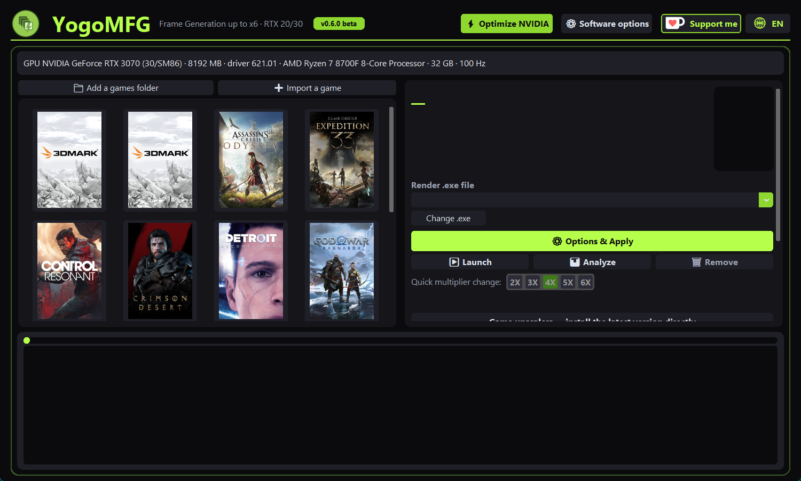
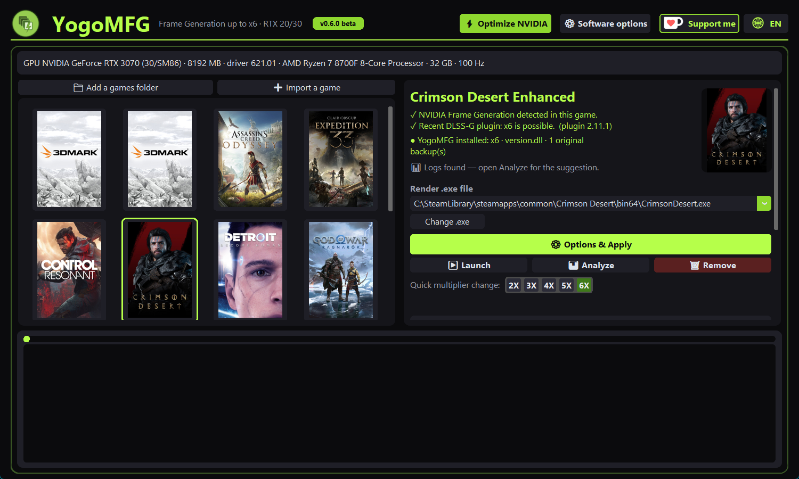
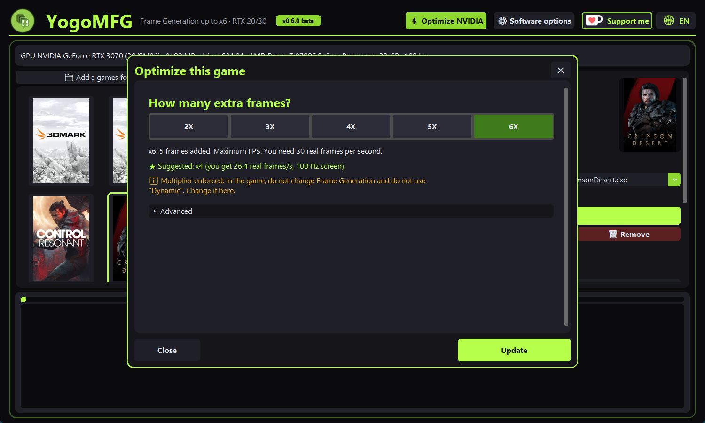
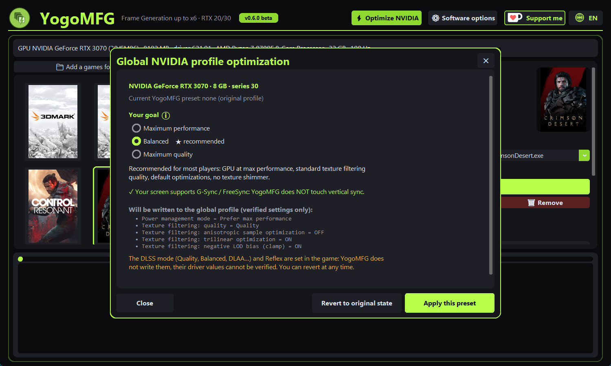
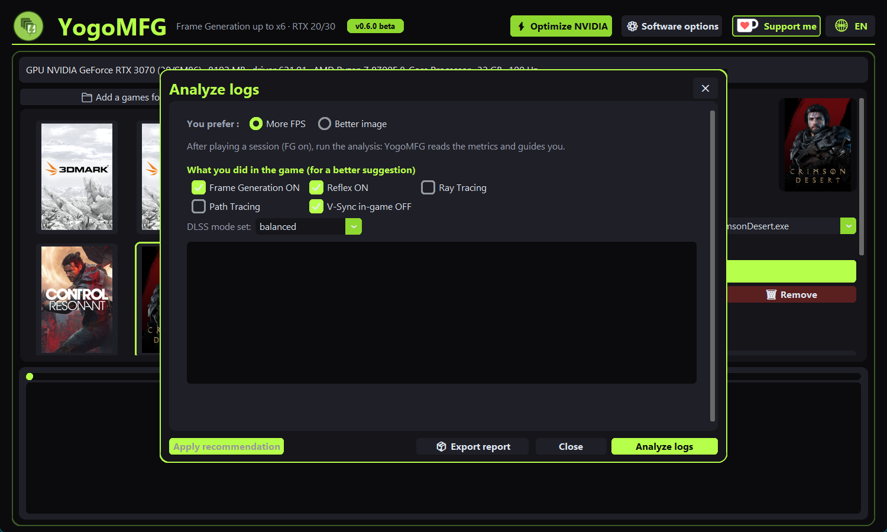
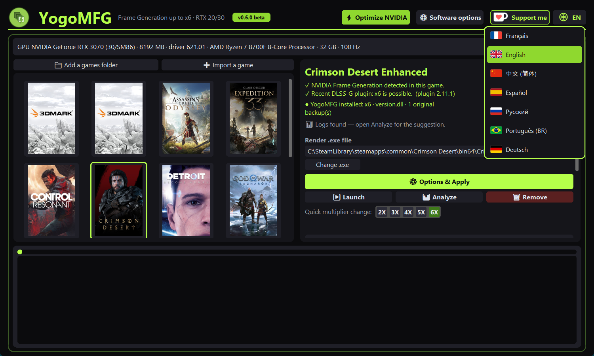

# YogoMFG

**DLSS Frame Generation up to x6 on NVIDIA RTX 20 and 30 cards — in a few clicks.**

🇫🇷 [Lire en français](README.fr.md)

YogoMFG installs the open-source **SM86 / SM75 Frame Generation mod** into your Steam games, tunes the game's
NVIDIA profile (FPS cap, G-Sync / FreeSync) and lets you pick the multiplier from **x2 to x6**. It then measures
your play session and explains, in plain words, what limits your FPS.

> Tested by the author: RTX 3070 8 GB, Ryzen 7 8700F, 1440p 180 Hz G-Sync screen, **Crimson Desert** at x6 ≈ 160 FPS
> displayed, smooth in steady state. Your results depend on your game, your card and your settings.

> ⛔ **Single-player / offline games only.** Never use YogoMFG in an online game or a game with anti-cheat:
> permanent-ban risk. Read [ANTICHEAT.md](ANTICHEAT.md) (EN, FR, ES, DE, PT-BR, IT, 中文).

---

## A free project, made to help

YogoMFG is a **non-profit, free project**. It exists for mutual help: improve everyone's quality of life in games and
**extend the life of older graphics cards** instead of throwing them away.

A big **thank you** to everyone who downloads, tests and shares it. This is a beta: your feedback is what makes it better.

- Found a bug? A game that behaves strangely? A question? **Tell us — we are here to solve it.**
- Easiest way to report: play 3–5 minutes with *Advanced → Measure the session* ticked, close the game, then
  **Analyze → 📦 Export report**, and send us the `.zip` (settings and logs, your Windows user name removed).
- Open an issue on the project page, or contact the author directly.

If YogoMFG helped you and you want to support the work: ☕ **[ko-fi.com/lahlouyoussef](https://ko-fi.com/lahlouyoussef)**
The Ko-fi link is open to **every kind of support**: a coffee, a one-off **donation**, a monthly membership, or simply a
kind message. It is never required — the tool stays free.

---



## What it does

- **One cover grid for all your games**: Steam libraries are found automatically; add any folder or import a single game.
- **Tells you if a game supports Frame Generation**, and its real ceiling (some games cap at x4).
- **Multiplier x2 → x6**, switchable later without reinstalling. Changes the NVIDIA driver override for you.
- **Simple mode** (one choice + one button) and a folded **Advanced** panel where every control is explained.
- **NVIDIA profile tuning** per game (FPS cap, VRR). Backups are exported first, every write is read back and verified.
- **Upscaler manager**: detects DLSS / FSR / XeSS in the game and updates the DLL.
- **Session measurement and analysis**: real FPS, GPU time, PCIe link, power and thermal throttling → a clear verdict.
- **7 languages** with flags: English, Français, Español, Deutsch, Português, Русский, 中文 (chosen from the globe button).
- **Clean removal**: *Remove* restores the game's original files.

## What you need

Windows 10/11 64-bit · NVIDIA **RTX 20 or 30** card · recent NVIDIA driver · administrator rights · a Steam game that
already has DLSS Frame Generation (Streamline `sl.dlss_g`).

Not useful on RTX 40/50: they have Frame Generation natively.

## Install and use

1. Run `YogoMFG-Setup-<version>.exe` (or the portable `YogoMFG.exe`) and accept the anti-cheat warning.
2. Click your game's **cover**. YogoMFG says whether the game supports Frame Generation and what its ceiling is.
3. **Options & Apply** → pick the multiplier → **Optimize**.
4. Start the game with YogoMFG's **Launch** button.
5. To change multiplier later: use the quick row on the game's card, then restart the game.

Your settings live in `%LOCALAPPDATA%\YogoMFG`.

### Step by step

**1 — Pick your game.** Click its cover. The right-hand card tells you whether the game supports Frame Generation, which
DLSS-G plugin it has (and so its ceiling), and whether YogoMFG is already installed. Use *Add a games folder* or
*Import a game* if a game is missing.



**2 — Choose the multiplier.** *Options & Apply* opens a single question: *how many extra frames?* The suggestion under
the buttons comes from your screen's refresh rate and, once you have played, from your measured real FPS.
Everything else is decided for you; *Advanced* is folded away and every control in it is explained.



**3 — (Optional) Optimize NVIDIA.** One goal to choose (performance / balanced / quality), a plain list of what will be
written, and a *Revert to original state* button. On G-Sync / FreeSync screens, V-Sync is never touched.



**4 — Play, then Analyze.** Start the game with **Launch**. Afterwards open **Analyze**: tell it what you used in the game,
and it reads the logs and gives a verdict. *Export report* builds the `.zip` to send us if something is wrong.



**Language.** The globe button (top right) switches between 7 languages.



## Which multiplier will my game really get?

The ceiling depends on the game, not on your card. Measured by us, from real session logs (RTX 3070):

| Game | Plugin in game folder | Result |
|---|---|---|
| Crimson Desert | 2.11.1 | **x6** |
| God of War Ragnarök | 2.4.15 (the game calls Frame Generation directly) | **x6** — the in-game menu only offers x2; the NVIDIA profile override forces more |
| Resident Evil Requiem | 2.8.0 | **x4 maximum** — the game ignores the driver's x6 request |

Other games are not tested yet. The plugin version alone does **not** tell the ceiling (see God of War vs. Resident Evil).
So YogoMFG does not guess: pick your multiplier, play a few minutes, and YogoMFG **measures** what the game really
delivered. It then shows "last measured: x4" on the game's card and greys out what that game cannot do.
Please send us your results (*Analyze → Export report*) to grow this list.

## Good to know (beta)

- **x5 / x6** need a game with a recent DLSS-G plugin (≥ 2.11.1). Otherwise the game caps at x4 or less.
- With the *enforced multiplier* (on by default), do **not** change Frame Generation in the game's menu and do not use
  "Dynamic": change it in YogoMFG.
- On a G-Sync / FreeSync screen YogoMFG **never forces V-Sync**.
- Another Frame Generation mod in the game folder (OptiScaler, dlssg-to-fsr3, DLSS Enabler…) blocks applying: remove it first.
- x6 needs video memory: on 8 GB cards, lower textures if you stutter. Frame Generation multiplies the *real* FPS;
  aim for 30+ real FPS before generation.
- YogoMFG writes the **NVIDIA driver profile** of the game. Do not press "Delete" on a game profile in NVIDIA
  Profile Inspector.

## Roadmap — next feature

**Frame Generation for games that do not support it** (older games), in the spirit of Lossless Scaling: very smooth,
without visible quality loss. This is the next mission, planned after a week of wider testing (more games,
more logs, e.g. Resident Evil Requiem and others). Your reports directly shape it.

## Credits

This project **stands on the work of others**. Many thanks to:

- **[sdli1995](https://github.com/sdli1995)** — original creator of the **SM86 / SM75 Multi-Frame Generation mod**
  ([dlssg_for_sm86](https://github.com/sdli1995/dlssg_for_sm86)). Without this mod, nothing here would exist.
  YogoMFG is an application built around it and does not replace it — please go and star the original repository.
- **[Coldwood1026](https://github.com/Coldwood1026/dlssg_for_sm75)** — the SM75 kernel family (RTX 20 series).
- **[Orbmu2k](https://github.com/Orbmu2k/nvidiaProfileInspector)** — NVIDIA Profile Inspector, used to read and write
  driver profiles.
- **[beeradmoore](https://github.com/beeradmoore/dlss-swapper)** — DLSS Swapper, whose public DLL manifest is used for
  upscaler updates.
- **Claude Code** (Anthropic) — contributed to the development of YogoMFG, through the Visual Studio Code extension.
- The **testers** and everyone who sends feedback.

## Licenses and legal

- YogoMFG source code: **MIT** — see [LICENSE](LICENSE).
- The **dlssg_sm86** mod code is MIT; the NVIDIA DLLs and compiled kernels it ships are binary-only and **not** MIT.
- NVIDIA Profile Inspector: MIT. Ko-fi logo © Ko-fi Labs.
- Full texts and notices: folder [legal/](legal/).
- Independent project, **not affiliated with NVIDIA, AMD, Intel, Valve or any game publisher**. Use at your own risk,
  no warranty.

## Build from source

```
pip install -r requirements.txt
python yogomfg.py          # run
scripts\build.bat          # build dist\YogoMFG\YogoMFG.exe (run as administrator for the NVIDIA panel)
```

The mod payload (`mod/`) and `tools/npi/` are not in the repository: place them before building.
