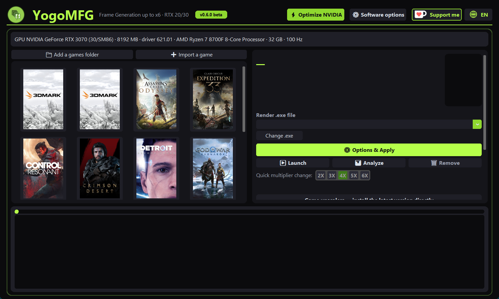
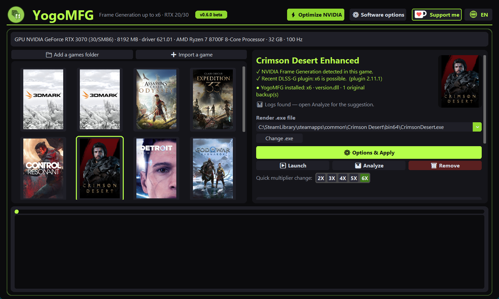
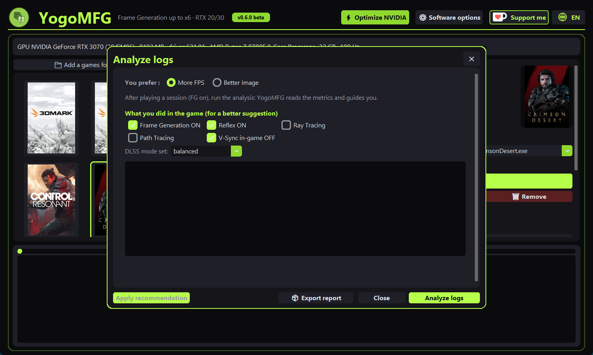
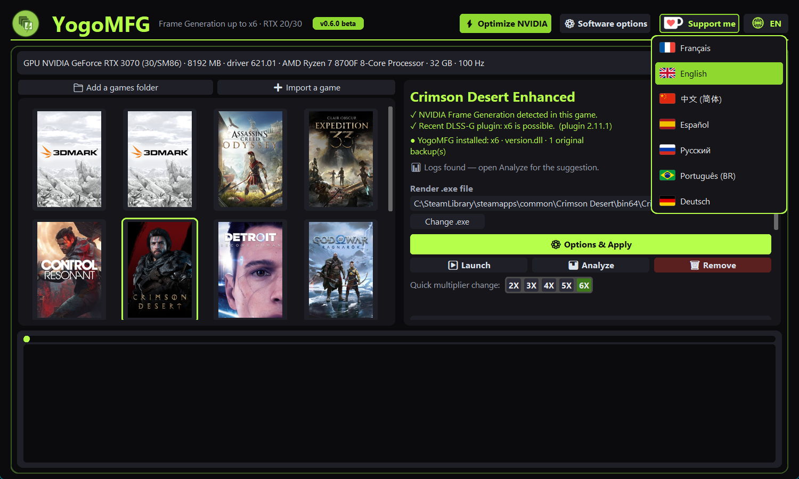

# YogoMFG

**DLSS Frame Generation on NVIDIA RTX 20 and 30 cards — one click to turn it on, one click to remove it.**

🇫🇷 [Lire en français](README.fr.md)

YogoMFG installs the **SM86 / SM75 Frame Generation mod** (third-party binaries, see [The mod and its
safety](#the-mod-and-its-safety)) into your Steam games and sets the game's NVIDIA profile. You press **Optimize this
game**: YogoMFG picks everything for a clean image, without ghosting. You press **Remove and restore**: the game's
original files come back, checked byte for byte, without Steam. It then measures your play session and explains, in
plain words, what limits your FPS.

> Tested by the author: RTX 3070 8 GB, Ryzen 7 8700F, 1440p 180 Hz G-Sync screen, **Crimson Desert** at x6 ≈ 160 FPS
> displayed, smooth in steady state. Your results depend on your game, your card and your settings.

> ⛔ **Single-player / offline games only.** Never use YogoMFG in an online game or a game with anti-cheat:
> permanent-ban risk. Read [ANTICHEAT.md](ANTICHEAT.md) (EN, FR, ES, DE, PT-BR, IT, 中文).

---

## A free project, made to help

YogoMFG is a **non-profit, free project**. It exists for mutual help: improve everyone's quality of life in games and
**extend the life of older graphics cards** instead of throwing them away.

A big **thank you** to everyone who downloads, tests and shares it. This is a beta: your feedback is what makes it better.

- Found a bug? A game that behaves strangely? A question? **Tell us — we are here to solve it.**
- Easiest way to report: optimize the game, play 3–5 minutes (the session is always measured), close the game, then
  **Software options → 📦 Export report**, and send us the `.zip` (settings and logs, your Windows user name removed).
- Open an issue on the project page, or contact the author directly.

If YogoMFG helped you and you want to support the work: ☕ **[ko-fi.com/lahlouyoussef](https://ko-fi.com/lahlouyoussef)**
The Ko-fi link is open to **every kind of support**: a coffee, a one-off **donation**, a monthly membership, or simply a
kind message. It is never required — the tool stays free.

---



## What it does

- **One cover grid for all your games**: Steam libraries are found automatically; add any folder or import a single game.
- **Tells you if a game supports Frame Generation.**
- **Optimize this game** — one button, nothing to choose. The target is your fastest screen's refresh rate (3 FPS
  under it on G-Sync / FreeSync, so the screen stays in its variable range); that target is also the FPS cap written
  into the game's NVIDIA profile. The multiplier always stays between **x3 and x6** (x2 is left to AMD's FSR Frame
  Generation). The first time, it aims at about 55 real frames per second: 144 Hz → x3, 180 Hz → x3, 240 Hz → x4,
  360 Hz → x6. After you have played a few minutes, YogoMFG
  **calibrates** from the measured session (see below). The card shows the result in one line, for example
  *x3 · 59 rendered frames → 177 displayed*.
- **Remove and restore** — one button. Every file YogoMFG added is deleted, every game file it replaced is put back
  and checked (SHA-256), and the game's NVIDIA profile settings are undone. When no other game still uses YogoMFG,
  the global NVIDIA values are put back too. No Steam "verify files" needed.
- **What is written in the NVIDIA driver**: in the game's profile, the FPS cap, G-Sync / FreeSync (when the screen
  supports it) and the number of generated frames. In the global profile, only the Frame Generation *ceiling*
  (up to x6, so games are allowed to reach it) and G-Sync / FreeSync for fullscreen and windowed games; never a
  forced multiplier, which would apply to every game. The original global values are saved first.
- **One click is your consent**: there is no confirmation screen. Every write is read back and verified, shown in
  the console, and undone by *Remove and restore*.
- **Upscaler manager**: detects DLSS / FSR / XeSS in the game and updates the DLL.
- **Session measurement and analysis**: real FPS, GPU time, PCIe link, power and thermal throttling → a clear verdict.
- **7 languages** with flags: English, Français, Español, Deutsch, Português, Русский, 中文 (chosen from the globe button).

## What you need

Windows 10/11 64-bit · NVIDIA **RTX 20 or 30** card · NVIDIA driver **R580 or newer** (the mod refuses to start on an
older driver) · administrator rights · a Steam game that already has DLSS Frame Generation (Streamline `sl.dlss_g`).

Not useful on RTX 40/50: they have Frame Generation natively.

## Install and use

1. Run `YogoMFG-Setup-<version>.exe` (or the portable `YogoMFG.exe`) and accept the anti-cheat warning.
2. Click your game's **cover**. YogoMFG says whether the game supports Frame Generation.
3. Click **Optimize this game**. Nothing to confirm: the click is your consent.
4. Start the game with YogoMFG's **Launch** button and turn Frame Generation on in the game's graphics options.
5. To undo everything: **Remove and restore**.

Your settings live in `%LOCALAPPDATA%\YogoMFG`.

### Step by step

**1 — Pick your game.** Click its cover. The right-hand card tells you whether the game supports Frame Generation and
whether YogoMFG is already installed. Use *Add a games folder* or *Import a game* if a game is missing.



**2 — Optimize this game.** Before writing anything, YogoMFG moves every game file it would overwrite into
`YogoMFG_backup\` next to the game's `.exe`, with a `manifest.json` that lists each file, its SHA-256 and whether it was
replaced or added. Then it installs the mod with fixed, safe settings (image identical to NVIDIA's official runtime,
no lossy shortcuts) and writes the FPS cap, G-Sync / FreeSync and the multiplier into the game's NVIDIA profile. The
line under the buttons shows what you get, for example *x3 · 60 rendered frames → 180 displayed*.

**3 — Play.** Start the game with **Launch** and play 3 to 5 minutes. At the next **Optimise** click (or the next start),
YogoMFG reads the session by itself and recalibrates the multiplier. *Software options → Export report* builds the `.zip`
to send us if something is wrong.

**4 — Automatic calibration.** Every session is measured (real frames per second, GPU load; menus, pauses and cutscenes
are left out because Frame Generation stops there). After 3–5 minutes of play, the next *Optimize this game* click, or
the next start of YogoMFG, recomputes the multiplier and rewrites the mod settings and the game profile if it changed.
It tells you in one line, for example *Calibrated: x3, 59 real frames → 177 displayed*. The rule, in plain words:

- YogoMFG takes the real frame rate your card holds steadily (the low end of the session, not the average) and picks
  the **smallest** multiplier that still reaches the target. Fewer generated frames between two real frames means a
  cleaner image.
- If the real frame rate sits flat on a line while the card is not working flat out, the game (or you) capped it.
  YogoMFG respects that cap: target divided by the cap, rounded (a 60 FPS cap on a 180 Hz screen gives x3, 45 gives
  x4, 30 gives x6), and never more frames than the screen can show (that would cause judder or tearing).
- The multiplier stays between x3 and the highest value the game has proven it can deliver (x6 at most;
  Resident Evil Requiem stops at x4). If even that is not enough, YogoMFG uses the highest one and the G-Sync /
  FreeSync screen absorbs the difference.
- If the game would get fewer than 45 real frames per second, the setting is still applied but YogoMFG warns you:
  *less sharp image: lower a graphics setting in the game (DLSS Balanced, shadows)*. On entry-level cards (RTX 2050,
  RTX 2060), or when the measured base stays under 45, 30 real frames per second are accepted without a warning.

**5 — Remove and restore.** Deletes what YogoMFG added, puts back each replaced file, checks its SHA-256, then deletes
the backup folder, and undoes the game's NVIDIA profile changes. If a check fails, the backup folder is kept and
YogoMFG says which file. Installs made by YogoMFG 0.6.x (`.yogobak` files) are restored too.



**Language.** The globe button (top right) switches between 7 languages.



## Which multiplier will my game really get?

The ceiling depends on the game, not on your card. Measured by us, from real session logs (RTX 3070):

| Game | Plugin in game folder | Result |
|---|---|---|
| Crimson Desert | 2.11.1 | **x6** |
| CONTROL Resonant | 2.12.128 | **x6** |
| God of War Ragnarök | 2.4.15 (the game calls Frame Generation directly) | **x6** — the in-game menu only offers x2; the NVIDIA profile override forces more |
| Resident Evil Requiem | 2.8.0 | **x4 maximum** — the game ignores the driver's x6 request |

Other games are not tested yet. The plugin version alone does **not** tell the ceiling (see God of War vs. Resident Evil).
So YogoMFG does not guess: play a few minutes, and YogoMFG **measures** what the game really delivered. If the game
gave less than asked, that ceiling is remembered for this game and the next *Optimize* stays under it.
Please send us your results (*Software options → Export report*) to grow this list.

## Good to know (beta)

- **Clean image first**: the multiplier is the smallest one that reaches your screen's refresh rate. A high
  multiplier on a low real frame rate shows ghosting; YogoMFG avoids it on purpose.
- The multiplier is written into the game's NVIDIA profile: do **not** change Frame Generation in the game's menu and
  do not use "Dynamic". Just turn Frame Generation on.
- On a G-Sync / FreeSync screen YogoMFG **never forces V-Sync**.
- FreeSync screen: turn on "G-SYNC Compatible" once in NVIDIA Control Panel → Display → Set up G-SYNC. It is a
  setting of the screen, not of a profile, so YogoMFG can neither read nor change it.
- With several screens, YogoMFG assumes the game runs on the fastest one.
- Another Frame Generation mod in the game folder (OptiScaler, dlssg-to-fsr3, DLSS Enabler…) blocks applying: remove it first.
- High multipliers need video memory: on 8 GB cards, lower textures if you stutter.
- YogoMFG writes the **NVIDIA driver profile** of the game. Do not press "Delete" on a game profile in NVIDIA
  Profile Inspector.

## The mod and its safety

The Frame Generation mod is **not open source**: it is third-party closed binaries (a proxy `version.dll` and the
`dlssg_sm86\` folder) published on GitHub by **sdli1995**. YogoMFG 0.7.0 ships its release **0.4.1**, published by
Coldwood1026. The archive also contains NVIDIA's own DLSS DLLs, unmodified.

Checks done before shipping it:

- the SHA-256 of the downloaded GitHub zip matches the digest published with the release;
- Microsoft Defender scan: clean;
- the NVIDIA DLLs carry a valid NVIDIA signature; the mod's own DLLs are self-signed ("DLSSG Throwaway Test"), which
  proves they were not altered after signing but not who made them.

The limit: closed code cannot be fully audited. These checks show the files are the published ones and are not known
malware; they cannot prove what the code does. Use it only on single-player games, and keep *Remove and restore* in
mind if anything looks wrong.

## Roadmap — next feature

**Frame Generation for games that do not support it** (older games), in the spirit of Lossless Scaling: very smooth,
without visible quality loss. This is the next mission, planned after a week of wider testing (more games,
more logs, e.g. Resident Evil Requiem and others). Your reports directly shape it.

## Credits

This project **stands on the work of others**. Many thanks to:

- **[sdli1995](https://github.com/sdli1995)** — original creator of the **SM86 / SM75 Multi-Frame Generation mod**
  ([dlssg_for_sm86](https://github.com/sdli1995/dlssg_for_sm86)). Without this mod, nothing here would exist.
  YogoMFG is an application built around it and does not replace it — please go and star the original repository.
- **[Coldwood1026](https://github.com/Coldwood1026/dlssg_for_sm75)** — the SM75 kernel family (RTX 20 series).
- **[Orbmu2k](https://github.com/Orbmu2k/nvidiaProfileInspector)** — NVIDIA Profile Inspector, used to read and write
  driver profiles.
- **[beeradmoore](https://github.com/beeradmoore/dlss-swapper)** — DLSS Swapper, whose public DLL manifest is used for
  upscaler updates.
- **Claude Code** (Anthropic) — contributed to the development of YogoMFG, through the Visual Studio Code extension.
- The **testers** and everyone who sends feedback.

## Licenses and legal

- YogoMFG source code: **MIT** — see [LICENSE](LICENSE).
- The **dlssg_sm86** mod is distributed as binaries only. Its `LICENSE.md` names the MIT license for the author's own
  source, which is not published with the release; the NVIDIA DLLs and compiled kernels it ships are **not** MIT (see
  the mod's `THIRD_PARTY_NOTICES.txt`).
- NVIDIA Profile Inspector: MIT. Ko-fi logo © Ko-fi Labs.
- Full texts and notices: folder [legal/](legal/).
- Independent project, **not affiliated with NVIDIA, AMD, Intel, Valve or any game publisher**. Use at your own risk,
  no warranty.

## Build from source

```
pip install -r requirements.txt
python yogomfg.py          # run
scripts\build.bat          # build dist\YogoMFG\YogoMFG.exe (run as administrator for the NVIDIA panel)
```

The mod payload (`mod/`) and `tools/npi/` are not in the repository: place them before building.
